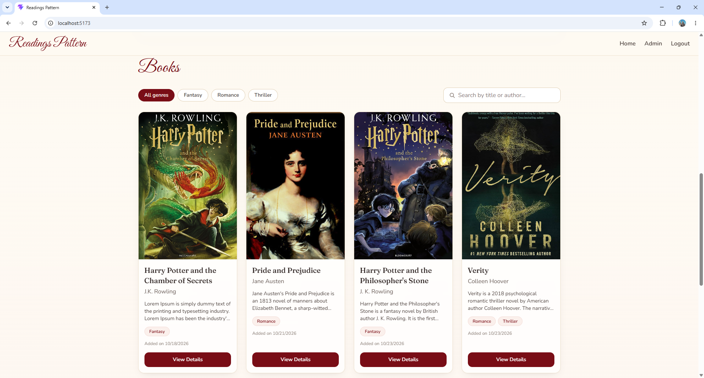
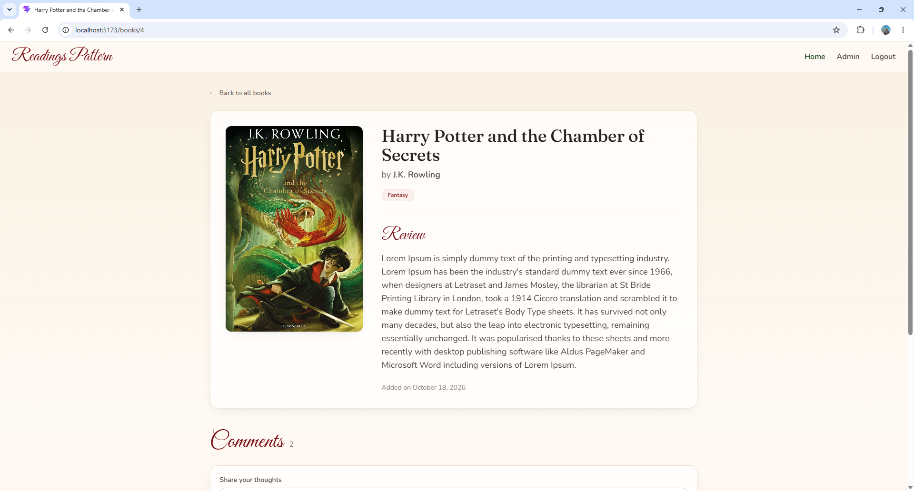
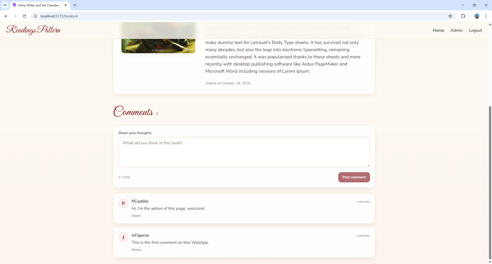
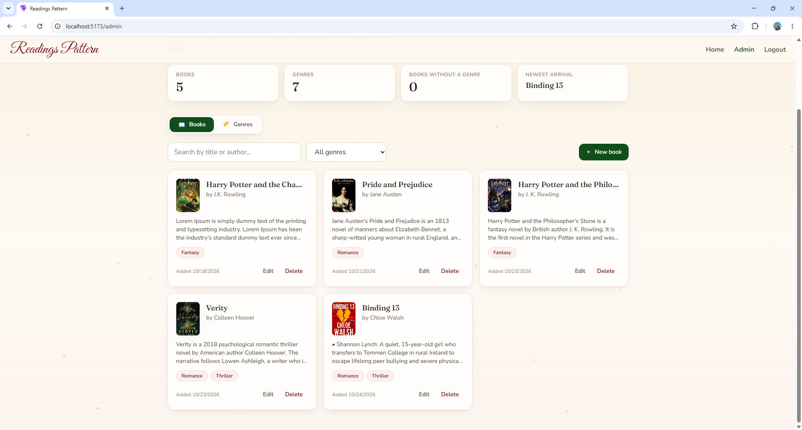

# Readings Pattern

A full-stack personal book review application where visitors can browse books by genre or author, read reviews, and participate in discussions through comments.

The application includes JWT authentication, role-based authorization, layered architecture, unit testing and an admin dashboard for managing books, genres, and comments.

> This project was created as a portfolio project to demonstrate my backend development skills with ASP.NET Core, Entity Framework Core, REST APIs, authentication, and layered architecture.

## Screenshots

<!-- Replace these with your own images -->

### Home page


### Book details and comments



### Admin dashboard


## Features

### Visitors

- Browse books and reviews
- Filter books by genre
- Browse books by author
- View comments

### Authenticated users

- Post comments on book reviews
- Delete their own comments
- Access protected functionality using JWT authentication

### Administrators

- Create, update, and delete books
- Create, update, and delete genres
- Delete any user's comment
- Access a role-protected admin dashboard

## Technology Stack

### Backend

- ASP.NET Core Web API
- Entity Framework Core
- JWT authentication
- Role-based authorization
- Three-layer architecture
- SOLID design principles

### Frontend

- React
- JavaScript
- CSS
- Axios 

### Database

- MSSQL

### Domain Model

Entities:

- User
- Book
- Genre
- BookGenre
- Comment

Relationships:

- One User can create many Books
- One User can create many Comments
- Books and Genres have a many-to-many relationship
- Books can contain many Comments

## Architecture

The backend uses a three-layer architecture to separate responsibilities:

```text
API / Presentation Layer
        |
        v
Business / Service Layer
        |
        v
Data Access Layer
        |
        v
Database
```

- **API layer:** Controllers, HTTP requests, responses,
- **Business layer:** Application logic, validation, and service interfaces
- **Data access layer:** Entity Framework Core, repositories, 

This separation helps keep the application maintainable and testable.

## Authorization Rules

| Action | Visitor | Authenticated User | Admin |
|---|---:|---:|---:|
| Browse books | Yes | Yes | Yes |
| Read comments | Yes | Yes | Yes |
| Add a comment | No | Yes | Yes |
| Delete own comment | No | Yes | Yes |
| Delete another user's comment | No | No | Yes |
| Manage books | No | No | Yes |
| Manage genres | No | No | Yes |

Authorization is validated by the backend and does not rely only on hiding controls in the frontend.

## API Overview

Examples of available endpoints:

| Method | Endpoint | Description | Access |
|---|---|---|---|
| `GET` | `/api/books` | Get all books | Public |
| `GET` | `/api/books/{id}` | Get a book and its review | Public |
| `POST` | `/api/books` | Create a book | Admin |
| `PUT` | `/api/books/{id}` | Update a book | Admin |
| `DELETE` | `/api/books/{id}` | Delete a book | Admin |
| `GET` | `/api/genres` | Get genres | Public |
| `POST` | `/api/comments` | Add a comment | Authenticated |
| `DELETE` | `/api/comments/{id}` | Delete a permitted comment | Owner/Admin |
| `POST` | `/api//login` | Sign in and receive a JWT | Public |


## Getting Started

### Prerequisites

Install:

- [.NET SDK](https://dotnet.microsoft.com/download) version 8
- [Node.js](https://nodejs.org/) version v24.21.0 or later
- SQL Server 

### Clone the repository

```bash
git clone https://github.com/JcFigaroa/BooksReviewByPamela.git
cd BooksReviewByPamela
```

### Backend setup

Navigate to the API project:

```bash
cd backend/Your.Api.Project
```

Create an `appsettings.Development.json` file or configure user secrets:

```json
{
  "ConnectionStrings": {
    "DefaultConnection": "YOUR_LOCAL_CONNECTION_STRING"
  },
  "Jwt": {
    "Key": "YOUR_LOCAL_DEVELOPMENT_SECRET",
    "Issuer": "BookReviewApi",
    "Audience": "BookReviewClient"
  }
}
```

Apply the database migrations:

```bash
dotnet ef database update -p DataLayer -s BooksReviewByPamela
```

Start the API:

```bash
dotnet run
```

The API will be available at the URL displayed in the terminal.

### Frontend setup

Navigate to the frontend:

```bash
cd frontend
npm install
```

Start the development server:

```bash
npm run dev
```

> If you use Create React App instead of Vite, use the appropriate environment variable name and `npm start`.

## API Documentation

When running the backend locally, Swagger documentation is available at:

```text
https://localhost:YOUR_API_PORT/swagger
```

## Project Structure

```text
.
├── backend/
│   ├── BookReview.Api/
│   ├── BookReview.Business/
│   ├── BookReview.Data/
│   └── BookReview.Tests/
├── frontend/
│   ├── src/
│   └── public/
├── docs/
│   └── images/
└── README.md
```

Adjust this section to match the actual repository structure.

## Testing

Run backend tests with:

```bash
dotnet test
```

## Roadmap

- [ ] Add a contact page
- [ ] Add a blog section
- [ ] Deploy frontend and backend to Azure

## Development Notes

I focused primarily on designing and implementing the backend, including:

- REST API design
- Database modeling with Entity Framework Core
- Authentication and authorization
- Comment ownership enforcement
- Layered architecture
- Admin CRUD functionality

The frontend was integrated with a custom ASP.NET Core REST API and designed to support role-based functionality, comment management, and administrative workflows.

## Status

The MVP is complete. The application is not currently hosted, but it can be run locally using the instructions above.

## License

This project is licensed under the MIT License. See [LICENSE](LICENSE) for details.

## Author

**Jean-Carlos F.**

- GitHub: [@your-username](https://github.com/JcFigaroa)
- LinkedIn: [Your LinkedIn profile](https://linkedin.com/in/jean-carlos-figaroa-84b66118a)
